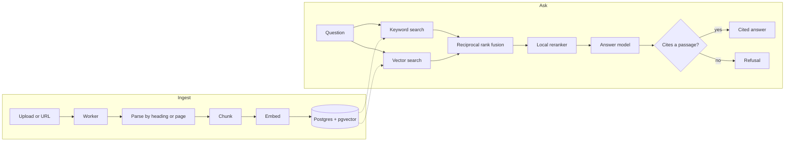

# LoreOS

[](https://github.com/Syddl/LoreOS/actions/workflows/ci.yml)
[](LICENSE)

Answers from your team's documents, with the passage each answer came from.

LoreOS is a self-hostable document Q&A engine. Put PDF, Markdown, text and Word files, or a web page, into a workspace, and ask a question:
- **The answer cites its sources.** Each citation opens the exact passage it came from.
- **It doesn't guess.** When the documents don't say, LoreOS replies "I couldn't find this in your documents."
- **Its retrieval is measured.** Every retrieval change is scored against a written evaluation set, and the [results table](#results) is generated from those committed runs.

## Features

- **Hybrid retrieval:**
  - vector search (pgvector);
  - keyword search (Postgres full-text);
  - reciprocal rank fusion;
  - a local cross-encoder reranker that runs on the CPU, with no GPU and no extra API.
- **Cited answers, with a refusal** when the documents don't hold the answer.
- **Workspaces** isolated by Postgres row-level security, with email-and-password accounts, invite links, and owner and member roles.
- **A background worker** that ingests uploads and web pages, with retries.
- **An HTTP API** with per-workspace keys.
- **One Postgres:** any Postgres with pgvector. Supabase works through its session pooler, and nothing else is needed: no vector database, no queue, no cache.
- **`docker compose up`:** one image runs the migration, the api and the worker.

**Status:** v1 is in progress. Everything above works today. The embeddable widget is next. The plan and its decisions are in [docs/sdd/v1/brief.md](docs/sdd/v1/brief.md).

## Quickstart

You need three things:
- **Docker.**
- **Postgres with pgvector.** Supabase works: use its session pooler connection string.
- **An OpenAI API key.** Every upload and every question spends on it.

```sh
cp .env.example .env   # then fill in DATABASE_URL and OPENAI_API_KEY
docker compose up --build
```

`docker compose up` migrates the database, then starts the api and the worker. The worker embeds each queued document through OpenAI. It runs only when you start it: Docker never restarts it on its own.

Open http://localhost:8000 and sign up:
- the first account owns the first workspace, and signup then closes;
- everyone else joins through an invite link, made in the workspace's settings.

### Without Docker

With [uv](https://docs.astral.sh/uv/) and Node 22:

```sh
npm ci --prefix frontend
npm run db:migrate
npm run dev:api        # the api on 127.0.0.1:8000
npm run dev:web        # the UI with hot reload; it forwards /api to the api
npm run paid:worker    # processes uploads, through your OpenAI key
```

## Configuration

Settings come from the environment, or from `.env` at the repository root. [.env.example](.env.example) lists each one with its default.

| Setting | What it does |
|---|---|
| `DATABASE_URL` | Postgres with pgvector. On Supabase, use the session pooler string on port 5432. The transaction pooler on port 6543 breaks prepared statements, and LoreOS refuses it. |
| `OPENAI_API_KEY` | Embeddings and answers. |
| `OPENAI_BASE_URL` | Empty for api.openai.com. Otherwise an OpenAI-compatible server with structured output. |
| `EMBEDDING_MODEL` | The embedding model. It must return 1536 dimensions. |
| `ANSWER_MODEL` | Drafts the cited answer. |
| `JUDGE_MODEL` | Grades faithfulness, in the evaluation only. |
| `RERANK` | `on` (the default) or `off`. `off` serves vector search alone, without the reranker's CPU and memory. See [decision 0010](docs/decisions/0010-reranker-and-default-mode.md). |
| `ALLOWED_HOSTS` | The host names the api answers, comma-separated. Add your domain. |

**Behind a TLS proxy:**
- add the domain to `ALLOWED_HOSTS`;
- set `FORWARDED_ALLOW_IPS` to the proxy's own address, never `*`. uvicorn reads it, so client addresses reach the login rate limit.

Over https the session cookie is `Secure`.

## How it works



1. **Parsing.**
   - PDFs are read page by page.
   - Markdown, Word files and web pages are split by heading.
   - Each section keeps its heading path or page number.
2. **Chunking.** LoreOS's own chunker packs each section into chunks of 500 tokens with a 50-token overlap, never across sections. That size was measured in vector mode against 250 and 1000 ([decision 0009](docs/decisions/0009-chunk-size-500-overlap-50.md)).
3. **Vector search.** Each chunk is embedded together with its heading path. The question's embedding finds the nearest chunks by cosine distance in pgvector.
4. **Keyword search.** Postgres full-text search, over the heading path and the text, matches any word of the question. Postgres ranks without corpus-wide statistics, so LoreOS calls this keyword search.
5. **Fusion.** Reciprocal rank fusion merges the vector and keyword rankings.
6. **Reranking.** A local cross-encoder, `ms-marco-MiniLM-L-6-v2` run on the CPU through fastembed, rescores the top fused passages.
   - It serves by default because it measured best.
   - Fusion without it measured worse than vector search alone on this corpus ([decision 0010](docs/decisions/0010-reranker-and-default-mode.md)).
7. **Answering.**
   - The answer model reads the top passages and must cite them as `[n]`.
   - A marker that points at no passage is dropped.
   - An answer left with no valid citation becomes the refusal.
8. **Isolation.**
   - Postgres row-level security separates each workspace's documents and chunks.
   - A test proves one workspace's credentials read none of another's rows.
   - `npm run db:verify-rls` checks a live database.

## Results

<!-- results:start -->
<!-- Generated by npm run readme:table from eval/results/. Do not edit by hand: npm run check:readme compares it. -->

| Retrieval | Recall@5 | MRR@10 | Citation accuracy | Unanswerable refused | Answerable wrongly refused | Faithfulness | Search p50 | Search p95 |
|---|---|---|---|---|---|---|---|---|
| Vector search only | 0.909 | 0.825 | 0.709 | 1.000 | 0.076 | 0.918 | 1306 ms | 2112 ms |
| + keyword search, fused with RRF | 0.864 | 0.682 | 0.644 | 1.000 | 0.061 | 0.855 | 1599 ms | 2151 ms |
| **+ local reranker (served by default)** | 0.924 | 0.855 | 0.759 | 1.000 | 0.061 | 0.968 | 3655 ms | 6079 ms |

Measured at commit `c221b3a` ([vector](eval/results/20261014T103002Z-vector-c221b3a3.json), [hybrid](eval/results/20261014T104308Z-hybrid-c221b3a3.json), [hybrid_rerank](eval/results/20261014T123854Z-hybrid_rerank-c221b3a3.json)): 81 questions, 66 of them answerable, over the [evaluation corpus](eval/corpus.json).
Embeddings `text-embedding-3-small`, answers `gpt-5.4-mini`, faithfulness judged by `gpt-6-luna`, reranker `Xenova/ms-marco-MiniLM-L-6-v2`. Chunks of 500 tokens with 50 of overlap; the answer model reads the top 5.
Judge agreement with Claude's grades of 30 calibration answers: 1.000. Search time is one question at a time on the machine that ran the evaluation, and includes the question's embedding call.
<!-- results:end -->

**How each column is scored** (the full method is in [eval/README.md](eval/README.md)):
- **Recall@5:** for each answerable question, the share of its labelled sections found among the top 5 passages, averaged.
- **MRR@10:** the reciprocal rank of the first labelled passage within the top 10, averaged.
- **Citation accuracy:** the share of the answers' citations that point at a labelled section.
- **Unanswerable refused:** the share of questions the documents do not answer that end in the refusal.
- **Answerable wrongly refused:** the share of answerable questions that end in it.
- **Faithfulness:** the share of answers whose every claim is supported by the passages they cite, as the judge model grades them. The judge's agreement with Claude's grades of the calibration answers is in the caption ([decision 0008](docs/decisions/0008-calibration-graded-by-claude.md)).

**How the table is made:**
- the result files are written by `npm run paid:eval` and never edited by hand;
- the table is written by `npm run readme:table`;
- `npm run check:readme` fails when the two disagree.

## API

Create a key in a workspace's settings, under API keys.
- It is shown once, and it starts with `lo_sk_`.
- It has a member's access to that workspace alone: it can add documents, list them and ask.

```sh
LOREOS=http://localhost:8000
KEY=lo_sk_...                # from the workspace's settings, under API keys
WS=...                       # the workspace id, from the address bar: /w/<id>

# Add a file. The same bytes again are stored once.
curl -H "Authorization: Bearer $KEY" -F file=@handbook.pdf "$LOREOS/api/workspaces/$WS/documents"

# Import a web page
curl -H "Authorization: Bearer $KEY" -H "Content-Type: application/json" \
  -d '{"url": "https://example.com/page"}' "$LOREOS/api/workspaces/$WS/documents"

# List documents: each goes from pending to processed, or to failed with its error
curl -H "Authorization: Bearer $KEY" "$LOREOS/api/workspaces/$WS/documents"

# Ask
curl -H "Authorization: Bearer $KEY" -H "Content-Type: application/json" \
  -d '{"question": "When do production deploys happen?"}' "$LOREOS/api/workspaces/$WS/ask"
```

An answer looks like this; `found` is false, with the refusal as `answer`, when the documents don't say:

```json
{
  "found": true,
  "answer": "... [1].",
  "citations": [
    {"n": 1, "chunk_id": "...", "document_id": "...", "filename": "...", "heading_path": ["..."], "page": null, "text": "..."}
  ],
  "reason": null,
  "retrieval_mode": "hybrid_rerank"
}
```

## Demo

To try LoreOS on the evaluation corpus, part of the GitLab handbook and a few US government PDFs:

1. Run `npm run eval:fetch`. It downloads the corpus and checks each file's hash.
2. Create a workspace in the UI, and copy its id from the address bar.
3. Run `npm run paid:demo-load -- --workspace-id <id>`.
   - A free preflight runs first, then it embeds the corpus into that workspace.
   - `--dry-run` shows the plan without spending.
   - A second run adds nothing.

## Development

```sh
docker compose --profile test up -d testdb   # the test database
npm run check:all                            # every check CI runs, except the image build
npm run check:compose                        # the image build and the stack, in CI's own job
```

Every command that calls OpenAI is a `paid:` script. Each is listed in [package.json](package.json).

## Contributing

Issues and pull requests are welcome.
- `npm run check:all` passes before a pull request. CI runs the same checks, and builds the image.
- A change to retrieval comes with an evaluation run (`npm run paid:eval`, which spends on your key), and its result files are committed as the run wrote them. The README's numbers are regenerated from those files with `npm run readme:table`, never edited by hand.
- [AGENTS.md](AGENTS.md) lists the project's rules. The [decisions](docs/decisions/) record why things are the way they are.

## Security

Please report a vulnerability privately, through the repository's Security tab ("Report a vulnerability"), rather than in a public issue.

[docs/KNOWN-GAPS.md](docs/KNOWN-GAPS.md) lists the gaps already known, each with the condition that would make it worth fixing.

## License

LoreOS is under the [MIT license](LICENSE).

The evaluation corpus is not in this repository: `npm run eval:fetch` downloads it.
- Its GitLab handbook text is under CC BY-SA 4.0 (https://creativecommons.org/licenses/by-sa/4.0/).
- Its PDFs are US government works.
- [Decision 0003](docs/decisions/0003-evaluation-corpus-and-judge.md) has the details.
- A workspace loaded with that corpus holds the text under those terms.
